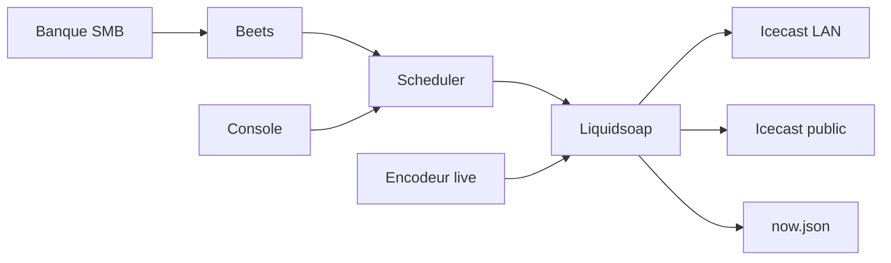

# L’automate BUTTON

Ce que fait la radio automatique, comment elle est faite, et où elle tourne. Photo de septembre 2026.

Les cahiers [`automate.md`](automate.md) et [`automate-horloges.md`](automate-horloges.md) décrivent une **cible**. Ce fichier décrit **ce qui est en place**. Ports et santé : [`architecture.md`](architecture.md). Exploitation Nasgul : dépôt `button-ops`, `runbook-nasgul.md`.

La phase 0 (plusieurs radios) se travaille dans le projet `automate`, à côté de celui-ci. L’accord sur Radiotomate est signé le 27 septembre 2026 : le moteur y est copié. Nasgul déploie encore cette copie-ci.

| | |
|---|---|
| Licence | AGPL-3.0-or-later (fork de [Radiotomate](https://radiotomate.org/), Martin Kirchgessner) |
| Prod | Nasgul (TrueNAS), Docker Compose. La VM Labomedia / Podman du plan initial n’est pas utilisée. |
| Code | `radiotomate/` dans ce dépôt ; console dans `button-console` ; infra dans `button-ops` |

## En une page

L’automate décide **quoi** passe et **quand**. Liquidsoap mélange le son et l’envoie vers Icecast. Personne n’a à rester devant une console pour que la radio continue.

Trois gestes suffisent au quotidien :

- déposer de la musique dans la banque, puis la promouvoir vers la rotation ;
- décrire des horloges (un motif : trois titres, un jingle, une pub à la minute 20) et les coller sur la semaine ;
- prendre l’antenne en direct quand un encodeur se connecte. Sinon l’horloge continue.

La console (`:30126`) est le pupitre : titre en cours, file, pads, et l’état de l’antenne (silence, sorties Icecast, alertes). L’interface Radiotomate (`:6811`) reste l’UI d’origine, en français.

## Ce qui sort

Liquidsoap choisit la source la plus prioritaire qui est prête :

`live` (harbor) > `relais` > `carts` > `jingles` puis `auto-DJ`.

Un encodeur autorisé coupe tout le reste. Sans encodeur, c’est l’horloge qui remplit les files.

Aujourd’hui la grille est simple :

- horloge **24/24 Rotation habillée** : trois titres de la catégorie Beets `Rotation`, puis un jingle (cart Jingles). Si la musique manque, le cart **Mimi** sert de repli ;
- horloge **Journée pubs** : musique, jingle, son Mimi. Le cart Pubs est encore vide, donc pas d’ancre pub pour l’instant.

Le flux public est ouvert depuis le 21 septembre 2026 : `http://radio.lazbutton.xyz:8000/button.mp3` (MP3 128 kbit/s). L’Icecast du LAN est sur le port `18000`, mount `/button.mp3`.

Pour ajouter des titres : les déposer dans `00-inbox/rotation/` (partage SMB `BUTTON-Media`), puis dans le conteneur dropbox :

```bash
docker exec button-radiotomate-dropbox-1 sh /promote-inbox.sh
```

Les WAV et AIFF deviennent des FLAC taggés, les MP3 gardent leur audio et reçoivent artiste / titre s’ils n’en ont pas. Les originaux partent dans `00-inbox/_sources/`. La boucle Beets indexe `10-rotation/` (groupe `rotation`, ReplayGain). La catégorie `Rotation` pointe sur ce dossier.

## Le modèle radio

```text
semaine (dayparts)
    └── une horloge par plage
            ├── motif séquentiel : musique, jingle, son, pub
            └── ancres : à une minute de l’heure (dure = on coupe, molle = on finit le titre)
                    └── conducteur : ~30 min d’items déjà choisis
                            └── files Liquidsoap : autodj, jingles, carts
```

| Mot | Sens |
|---|---|
| **Daypart** | Une plage de la semaine, reliée à une horloge. |
| **Horloge** | Recette nommée : un motif qui se répète, et éventuellement des ancres. |
| **Cart** | Une pile de sons (jingles, pubs, habillage) ou un relais. Par défaut le mode est **Horloge** : le cart ne joue que s’il est dans une horloge ou sur un pad. |
| **Catégorie** | Un nom et une requête Beets. `Rotation` = `path:/media/10-rotation`. |
| **Conducteur** | Ce qui *doit* sortir, écrit à l’avance. |
| **As-run** | Ce qui *est* sorti (`metadata_log`). Ce n’est pas le conducteur. |
| **Filet** | Pour un créneau live sans encodeur, le filet est la grille elle-même : l’horloge continue, il n’y a pas de silence. Une alerte le signale (EF-01). |

Le scheduler tire la musique en évitant de rejouer tout de suite le même artiste ou le même titre. Chaque titre envoyé à Liquidsoap porte son gain ReplayGain ; s’il manque, il est calculé avant l’envoi.

Le conducteur se recale sur l’heure réelle quand un titre passe à l’antenne. Les heures sont en heure de Paris, sans fuseau dans la base.

## Les pièces



| Pièce | Rôle |
|---|---|
| **Playout** | Liquidsoap 2.4.5. Mixe, normalise, sort vers Icecast. Entrée live sur le port `6800`. API interne `:6833`. |
| **Scheduler** | L’horloge. Toutes les secondes il regarde l’antenne ; il ne recalcule que si quelque chose a changé, à la minute, ou près de la fin du titre. |
| **Interface** | `:6811`. Comptes, carts, et l’API JSON que la console appelle. |
| **Console** | `:30126`. Pupitre (file, bibliothèque, pads) et bandeau de santé (silence, auditeurs, sorties, alertes). Clair ou sombre, au choix, mémorisé dans le navigateur. |
| **Dropbox** | Importe `10-rotation/` dans Beets et calcule le ReplayGain. |
| **Icecast local** | `:18000`. Le banc et le LAN. |
| **Now playing** | `:6820/now.json`. Ce que les players affichent. |
| **Catalogue** | `:30127`. Recherche dans la banque. |
| **Hub** | `:30120`. Panneau Projets : arrêter l’antenne pose un fichier `HOLD`, le cron ne la relance plus tant qu’on ne la rallume pas depuis le hub. |

Les conteneurs interface et scheduler partagent le réseau du playout. On ne redémarre pas le playout tout seul : les deux autres deviennent injoignables. Le script de déploiement les recrée ensemble.

## Où c’est

| Quoi | Où |
|---|---|
| Moteur, Liquidsoap, cette doc | dépôt `RC_WEB_RADIO`, dossier `radiotomate/` |
| Console React | dépôt `button-console` |
| Compose, cron, runbook | dépôt `button-ops` |
| Base, logs, config | `/mnt/data/apps/button/data/radiotomate` sur Nasgul |
| Fichiers audio | `/mnt/data/media/button` (SMB `BUTTON-Media`) |

Le cron Nasgul (`nasgul-update.sh`, toutes les 10 minutes) tire les images après la CI (tests Python et `liquidsoap --check`). Si le scheduler ne redevient pas sain, il revient à l’image précédente et pose `HOLD`.

Les alertes (silence, playout injoignable, battement perdu, direct sans encodeur, sortie Icecast coupée) ouvrent une tâche Vikunja et la ferment au rétablissement.

## Pas encore

- Brancher un vrai encodeur (BUTT) sur le harbor et valider un direct de bout en bout. La recette est dans [`live-qg.md`](live-qg.md).
- Les fondus. Liquidsoap 2.4 a encore le bug [savonet/liquidsoap#4179](https://github.com/savonet/liquidsoap/issues/4179) : les transitions de `fallback` ne fondent pas. Les enchaînements sont des coupes.
- Un certificat public (Caddy). Hors du LAN, l’accès passe par Tailscale. Caddy servira le jour où un encodeur doit entrer en HTTPS sans Tailscale.

Pour aller plus loin : [`architecture.md`](architecture.md) (ports), [`mediatheque.md`](mediatheque.md) (arbre de la banque), [`automate-horloges-plan.md`](automate-horloges-plan.md) (où en est le moteur par rapport au cahier), [`radiotomate/BUTTON.md`](../radiotomate/BUTTON.md) (ce qui a été modifié dans le fork).
